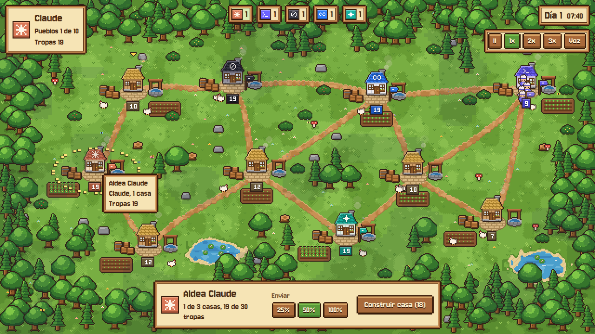
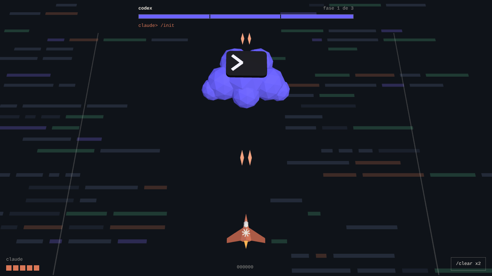

# AI Valley

Juego de estrategia en el navegador hecho con vibecoding. Yo escribí los prompts y la IA (Claude) escribió y probó el código.

- **Actividad:** Vibecoding Guiado: Desarrollo de una Aplicación o Mini-Juego con IA como Copiloto (Semana 2)
- **Curso:** AI For Devs Jr. 3, KODIGO Academy
- **Estudiante:** Wilmer Henry Salazar Martinez
- **IA de apoyo:** Claude (Anthropic), en claude.ai
- **Entrega:** domingo 18 de octubre de 2026



## Dónde está cada requisito

| Requisito de la actividad | Dónde verlo |
|---|---|
| Aplicación o mini-juego funcional | Secciones 1 y 2. También `docs/index.html`, que se abre sin instalar nada |
| Evidencia de vibecoding (3 prompts o más) | Sección 4 |
| Iteración y mejora | Sección 5 |
| Validación del resultado, errores y ajustes | Sección 6 |
| Comprensión del código | Sección 7 |
| Reflexión final | Sección 8 |

## 1. Qué es el juego

AI Valley es un juego de estrategia en tiempo real con estética pixel art de granja, inspirada en Stardew Valley. Cada IA (Claude, Codex, Grok, Muse de Meta y Gemini) tiene un pueblo. Los pueblos producen tropas. Las tropas caminan por los caminos de tierra, pelean y conquistan otros pueblos. Se gana cuando las otras IAs se quedan sin pueblos. Se pierde cuando uno se queda sin ninguno.

Reglas principales:

- Cada pueblo produce tropas solo. Con más casas (hasta 3) produce más, aguanta más tropas y defiende mejor. Construir una casa cuesta tropas y tarda 3,2 segundos.
- Las tropas pelean al llegar a un pueblo que no es suyo. Si los atacantes superan a los defensores, el pueblo cambia de dueño.
- Cada IA tiene una ventaja pequeña. Claude defiende un 12% mejor, Codex camina un 20% más rápido, Grok pega un 10% más fuerte, Muse produce un 12% más y Gemini construye un 20% más barato.
- Las IAs rivales juegan solas, cada una con una personalidad distinta. Hay tres dificultades.
- Hay ciclo de día y noche, lluvia, humo en las chimeneas, gallinas y mariposas. Son solo decoración.

Controles:

| Acción | Cómo |
|---|---|
| Elegir un pueblo propio | Clic o toque sobre él |
| Enviar tropas | Con un pueblo elegido, clic o toque en otro pueblo. También se puede arrastrar de uno a otro |
| Cantidad a enviar | Botones 25%, 50% y 100%, o las teclas Q, W y E |
| Construir una casa | Botón "Construir casa" o tecla U |
| Pausa, velocidad, sonido | Espacio, F y M |
| Quitar la selección | Esc o clic en un lugar vacío |

## 2. Cómo ejecutarlo

### Opción A: sin instalar nada

Abrir `docs/index.html` con Chrome, Edge o Firefox. Con internet carga la tipografía Jersey 10 de Google Fonts. Sin internet usa una tipografía de respaldo, que no probé a fondo.

### Opción B: desde el código

Requiere Node 18 o superior (lo probé con Node 22).

```bash
npm install
npm run dev
```

Abre `http://localhost:5173`. Otros comandos:

| Comando | Qué hace |
|---|---|
| `npm test` | Corre 13 pruebas automáticas de las reglas del juego |
| `npm run sim -- 30 normal` | Juega 30 partidas entre IAs sin gráficos y resume los resultados |
| `npm run bot` | Un bot juega como Claude contra las otras IAs en las tres dificultades |
| `npm run build` | Compila el juego a la carpeta `dist/` |

### Opción C: GitHub Pages (opcional)

Si el repositorio está en GitHub: Settings, Pages, rama `main`, carpeta `/docs`.

## 3. Lenguaje y herramientas

- **Lenguaje:** JavaScript con React 19, Vite y Canvas 2D. Son unas 4060 líneas en `src/`.
- **Sin imágenes externas:** las casas, los árboles y los personajes se dibujan píxel por píxel con código.
- **Por qué no Python:** la actividad sugiere Python, pero el lenguaje es libre. En el primer prompt pedí React con Three.js, así que seguí en JavaScript.
- **IA de apoyo:** Claude. Para probar, la IA usó Node, un navegador Chromium sin pantalla y capturas de pantalla.

## 4. Prompts usados (evidencia de vibecoding)

Resumen de lo que le pedí a la IA en cada prompt y del resultado que obtuve.

### Prompt 1: la idea inicial

**Qué pedí.** Un juego con React y Three.js donde Codex es el enemigo y una nave pequeña, que representa a Claude, lo ataca y salva el día.

**Resultado.** Un juego de naves en 3D llamado Claude vs Codex (carpeta `prototipos/claude-vs-codex`). Codex es un jefe con forma de nube y un prompt `>_` encima. Tiene tres fases: abanicos de balas, muros con un hueco y un rayo con aviso. La nave dispara sola y tiene una habilidad `/clear` que borra las balas. La IA definió los controles, la dificultad y la condición de victoria, y las dejó documentadas.

### Prompt 2: la mejora

**Qué pedí.** Cambiar la idea del juego: un juego en movimiento con casitas, estética tipo Stardew Valley y las IAs como protagonistas (Claude, Codex, Grok, el modelo de Meta y otras), con tropas y gráficos llamativos.

**Resultado.**

- Un juego de estrategia en tiempo real: pueblos con casas que crecen, conectados por caminos, y tropas que caminan para conquistarlos.
- Cambio de tecnología. Stardew Valley es 2D, así que se dejó Three.js y se usó Canvas 2D con React.
- La IA buscó en la web el nombre actual del modelo de Meta: Muse Spark, presentado el 8 de abril de 2026 por Meta Superintelligence Labs. Por eso la facción se llama Muse.
- Todo se dibuja con código (casas, árboles, soldados, emblemas) y el sonido se genera sin archivos de audio.

**Por qué cambié el enfoque.** El primer juego era una sola pantalla con un jefe. En este prompt di referencias concretas (Stardew Valley, los nombres de las IAs, las tropas) para que el estilo y la mecánica quedaran claros.

### Prompt 3: la entrega

**Qué pedí.** Un repositorio para esta actividad con el README en español. Junto con el prompt pegué el texto de la rúbrica de Moodle.

**Resultado.** La IA ordenó el código en este repositorio, escribió 13 pruebas automáticas, guardó capturas y resultados como evidencia, creó el historial de git y escribió este README siguiendo los puntos de la rúbrica.

## 5. Iteración y mejora

La mejora que pedí a la IA fue el prompt 2: pasar de un juego de naves a un juego de pueblos.

| Iteración 1 (prompt 1) | Iteración 2 (prompt 2) |
|---|---|
|  |  |

| | Iteración 1: Claude vs Codex | Iteración 2: AI Valley |
|---|---|---|
| Tipo de juego | Shooter de una pantalla | Estrategia en tiempo real |
| Tecnología | React Three Fiber (3D) | React y Canvas 2D (pixel art) |
| Personajes | Una nave y un jefe | 5 IAs con pueblos, casas y tropas |
| Cómo se juega | Esquivar y disparar | Enviar tropas, conquistar y construir |
| Duración de una partida | 1 a 2 minutos | 2 a 6 minutos (medido en simulaciones) |
| Extras | Sonido, 3 fases del jefe | Día y noche, lluvia, 3 dificultades, celular, sonido y música |

Dentro de la iteración 2 hubo además once ajustes más pequeños: tipografía, árboles, interfaz de celular, balance de las IAs y rendimiento. La IA los hizo al revisar sus propias pruebas, no fueron prompts míos. Están explicados uno por uno en la sección 6.4.

## 6. Validación del resultado

### 6.1 Pruebas automáticas

`npm test` corre 13 pruebas con el módulo de pruebas de Node (`tests/engine.test.mjs`). Resultado: 13 aprobadas, 0 fallidas (`evidencia/resultados/pruebas-automaticas.txt`). Revisan:

- El mapa siempre queda conectado y dentro de los límites, en 25 semillas y en formato horizontal y vertical.
- Cada IA empieza con un solo pueblo de 18 tropas y el resto de los pueblos son libres.
- La producción suma tropas por segundo y no pasa la capacidad.
- El combate: gana el atacante solo si supera a los defensores, y la defensa por nivel y el bono de Grok cuentan.
- Construir una casa cuesta tropas, tarda y sube el nivel. No se puede sin tropas suficientes ni pasar del nivel 3. Gemini paga un 20% menos.
- Enviar tropas deja al menos una en casa. La escuadra llega por el camino en el tiempo esperado.
- Las rutas empiezan y terminan donde deben y usan caminos reales.
- Se gana al eliminar a todas las IAs y se pierde al quedarse sin pueblos.
- La misma semilla da la misma partida.
- Una partida larga entre IAs no produce valores inválidos.

### 6.2 Simulaciones y balance

Un juego de estrategia se puede romper por los números aunque el código no tenga errores. Por eso hay dos scripts sin gráficos:

- `scripts/sim.mjs` juega partidas completas con las cinco IAs.
- `scripts/bot.mjs` hace que la IA juegue como Claude contra las otras cuatro. Sirve de referencia: una persona debería jugar mejor que este bot.

Resultados con la dificultad normal y las distintas versiones de la IA:

| Versión | Partidas | Terminaron | Victorias (Claude, Codex, Grok, Muse, Gemini) |
|---|---|---|---|
| Inicial | 8 | 5 | 0, 4, 0, 1, 0 |
| Pueblos llenos atacan con menos exigencia | 16 | 16 | 4, 6, 0, 3, 3 |
| Y personalidades de Grok y Codex ajustadas | 30 | 30 | 13, 9, 0, 5, 3 |
| Y posiciones iniciales sorteadas (versión final) | 30 | 30 | 8, 5, 3, 6, 8 |

En la versión final las partidas duran entre 128 y 352 segundos, con una media de 226 (unos 3,8 minutos). Con el bot jugando como Claude: dificultad tranquila 9 de 20 victorias, normal 7 de 20 y difícil 2 de 20. Los archivos completos están en `evidencia/resultados/`. Con 30 partidas el reparto de victorias todavía tiene ruido.

### 6.3 Pruebas en un navegador real

La IA abrió el juego en Chromium sin pantalla (con `puppeteer-core`) y recorrió estos flujos mirando la consola y las capturas:

- Pantalla de título, ayuda, elegir IA y dificultad, y jugar.
- Seleccionar un pueblo, enviar tropas, pausar.
- Vista de celular (390 x 844) y escena de noche.
- Una partida completa avanzada rápido dentro de la página, con un jugador automático, hasta la pantalla de fin de partida. Pasaron combates, conquistas, mejoras y eliminaciones.

Resultado final: 0 errores en la consola en todos los flujos. Las capturas están en `evidencia/`.

### 6.4 Errores encontrados y ajustes

Estos errores los encontró la IA con las pruebas que ella misma ejecutó. No los reporté yo.

| # | Qué pasaba | Cómo se encontró | Causa | Solución |
|---|---|---|---|---|
| 1 | El juego fallaba al abrir con `Cannot read properties of undefined (reading 'canvas')` | Consola del navegador | El primer cuadro de `requestAnimationFrame` puede traer un tiempo menor que `performance.now()`. El delta salía negativo y `Math.floor(-0.01) % 2` da `-1`, un índice que no existe | Forzar `dt >= 0` en el bucle, en la sesión y en el renderizador |
| 2 | Error al mostrar el título | Consola del navegador | Sin jugador humano `player` vale `-1`, y el código preguntaba si el pueblo libre (`-1`) podía mejorarse con la facción `-1` | `canUpgrade` devuelve falso para facciones negativas y el renderizador revisa `player >= 0` |
| 3 | Error justo al pulsar Jugar | Consola del navegador | Durante unos 100 ms el HUD leía la partida de fondo (`player = -1`) | Mostrar el HUD solo cuando el estado es de juego |
| 4 | Texto ilegible: "firme" se veía "Arme" y el 5 parecía un 8 | Captura de pantalla | La tipografía Pixelify Sans tenía ligaduras y glifos confusos | Cambiar a Jersey 10 y subir los tamaños |
| 5 | Árboles tapando caminos y pueblos | Captura de pantalla | La copa mide unos 28 px sobre el tronco y solo se revisaba la base | Revisar el área de la copa al colocar árboles |
| 6 | El anillo de selección casi no se veía | Captura de pantalla | Eran puntos claros sobre pasto claro | Anillo discontinuo con borde oscuro |
| 7 | Llovía desde el segundo 45 | Captura de pantalla | La lluvia dependía solo del reloj | Sin lluvia en los primeros 150 segundos |
| 8 | En celular se encimaban los paneles, el título quedaba cortado y la barra inferior tapaba un pueblo | Captura con viewport de 390 x 844 | Paneles con posición fija, centrado que corta el contenido y márgenes del mapa muy chicos | Rejilla CSS para pantallas angostas, centrado con márgenes automáticos y márgenes del mapa mayores |
| 9 | 3 de 8 partidas entre IAs no tenían ganador a los 25 minutos | `npm run sim` | Con todos los pueblos llenos, ninguna IA veía un ataque con la proporción mínima | Si el pueblo está lleno, la IA ataca con menos exigencia, porque producir más ya no le sirve |
| 10 | Grok no ganaba nunca (0 de 30) | `npm run sim` | La posición inicial dependía del orden de las facciones | Sortear las posiciones iniciales de las IAs |
| 11 | Cada cuadro costaba más de lo necesario | Medición en Node | El ruido de las sombras de nubes se recalculaba en cada cuadro | Recalcularlo unas 8 veces por segundo. Bajó de 14,8 a 9,4 ms por cuadro (actualizar y dibujar) |

### 6.5 Limitaciones

- No lo probé en un teléfono físico. La vista de celular se probó con un viewport emulado, con eventos de mouse y no táctiles.
- El audio no se pudo escuchar durante las pruebas. Hay que revisarlo a mano.
- Probé solo en Chromium. No lo probé en Firefox ni en Safari.
- La dificultad se calibró con bots, no con personas.
- Con la tipografía de respaldo (sin internet) el texto se ve más ancho y no revisé cómo queda.
- El HUD no tiene todavía soporte completo para lectores de pantalla.

### 6.6 Prueba manual (completar al probar)

- [ ] Abrir `docs/index.html` y elegir Claude con dificultad Normal.
- [ ] Seleccionar el pueblo propio y enviar el 50% de las tropas a un pueblo vecino.
- [ ] Arrastrar de un pueblo a otro para enviar tropas.
- [ ] Construir una casa con el botón y con la tecla U.
- [ ] Probar pausa (Espacio), velocidad (F) y sonido (M).
- [ ] Perder una partida a propósito y revisar la pantalla final.
- [ ] Abrirlo en un celular y probar con el dedo.
- Observaciones: _escribir aquí lo que se encontró_.

## 7. Cómo funciona el código

### 7.1 Mapa del proyecto

```text
.
├── docs/index.html        Versión de un solo archivo para jugar sin instalar
├── src/
│   ├── game/              Reglas del juego (no dependen de React ni del dibujo)
│   │   ├── constants.js   Facciones, niveles, costos, velocidades, dificultades
│   │   ├── rng.js         Números aleatorios con semilla
│   │   ├── map.js         Generación del mapa: pueblos, caminos, estanques, árboles
│   │   ├── engine.js      El mundo: producción, tropas, combate, construcción, victoria
│   │   ├── ai.js          Las IAs rivales y sus personalidades
│   │   ├── session.js     Une el motor, el dibujo y el mouse o el dedo
│   │   └── audio.js       Efectos y música generados con WebAudio
│   ├── render/            Todo lo que se dibuja
│   │   ├── pen.js         "Lápiz" de píxeles y contorno automático
│   │   ├── glyphs.js      Emblemas de cada IA y números de 3x5 píxeles
│   │   ├── art.js         Casas, árboles, soldados y objetos dibujados con código
│   │   ├── terrain.js     Pasto, caminos, plazas y estanques
│   │   └── renderer.js    Arma cada cuadro: capas, luz de día y noche, efectos
│   ├── ui/                Interfaz de React (HUD y pantallas)
│   ├── App.jsx            Canvas, bucle de animación y teclado
│   └── styles.css         Paneles de madera y pergamino
├── tests/engine.test.mjs  13 pruebas automáticas
├── scripts/               Simulaciones con bots y capturas desde Node
├── evidencia/             Capturas y resultados de pruebas
└── prototipos/            Iteración 1: Claude vs Codex (React Three Fiber)
```

### 7.2 Ideas clave

**Semilla.** El mapa, las posiciones iniciales y las decisiones de las IAs usan un generador con semilla (`rng.js`). La misma semilla da la misma partida. Eso permite probar de forma repetible.

**Mapa.** `map.js` hace cuatro pasos. Primero coloca los pueblos al azar pero a una distancia mínima. Segundo, une los pueblos con un grafo de Gabriel: dos pueblos se conectan si ningún otro queda dentro del círculo que tiene a ambos como diámetro. Tercero, si quedó algún grupo aislado, lo conecta. Cuarto, convierte cada unión en un camino curvo (curva de Bézier).

**Motor.** `World.update` avanza el tiempo en pasos de 0,05 segundos como máximo. En cada paso produce tropas, mueve las escuadras por los caminos, deja pensar a las IAs y revisa si alguien ganó. Las escuadras siguen una ruta de pueblos. Si pasan por un pueblo propio siguen. Si llegan a uno que no es suyo, pelean ahí.

**Combate.** Atacantes = tropas × ataque de la facción. Defensores = tropas × defensa del nivel × defensa de la facción. Si atacantes > defensores, el pueblo cambia de dueño y quedan (atacantes − defensores) / ataque tropas. Si no, quedan (defensores − atacantes) / defensa. Ejemplo: 12 tropas de Claude contra un pueblo libre de nivel 2 con 10 tropas. Los defensores valen 10 × 1,15 = 11,5. Como 12 > 11,5, Claude conquista y quedan 0,5 tropas, que se redondea a 1.

**Rutas.** `findPath` usa el algoritmo de Dijkstra. Al camino se le suma una penalización de 500 por pasar por un pueblo que no es propio, así prefiere rutas seguras si existen.

**IA rival.** Cada cierto tiempo (unos 2 segundos en normal) cada IA revisa sus pueblos: mejora casas si le sobran tropas, busca el ataque con mejor proporción de fuerzas contra defensores y manda refuerzos desde los pueblos del fondo hacia el frente. Las personalidades cambian el porcentaje que envían, la proporción mínima que aceptan y qué tan seguido construyen.

**Dibujo.** El juego se dibuja a una resolución pequeña (por ejemplo 640 x 360) en un canvas oculto. Después se agranda con interpolación "vecino más cercano", en múltiplos enteros cuando se puede, y por eso los píxeles se ven nítidos. Cada cuadro sigue este orden: terreno, objetos ordenados por altura (para que lo de abajo tape a lo de arriba), sombras, efectos, luz de día y noche (se multiplica un color sobre todo el cuadro), y al final lo que debe verse siempre: anillo de selección, números y textos flotantes.

**Sprites.** `art.js` dibuja con funciones simples (techo, pared, puerta, ventana). Luego `pen.outline()` recorre los píxeles y agrega un contorno oscuro de un píxel. Los colores de cada IA se cambian con una paleta, y los emblemas son mapas de bits de 7 x 7.

**React y el motor.** El motor vive fuera de React. React solo muestra la interfaz y consulta el estado cada 100 ms. Así no se vuelve a dibujar la interfaz 60 veces por segundo.

## 8. Reflexión final

<!-- Borrador. Revisar y reescribir con tus propias palabras antes de entregar. -->

### 8.1 Qué aprendí usando IA para programar

- Un prompt corto da un resultado correcto pero genérico. El prompt 1 produjo un juego de naves sencillo. El prompt 2 tenía más detalle (estilo, temas, tropas) y el resultado cambió por completo.
- Cuando cambia el tipo de idea, la IA cambia también de herramienta. Pasó de Three.js a Canvas 2D y explicó por qué.
- Probar es parte del trabajo. Los bots, las simulaciones y el navegador sin pantalla encontraron errores que no se veían leyendo el código.
- Los números de un juego se ajustan midiendo. Las simulaciones mostraron empates y una IA que nunca ganaba, algo que a ojo no se notaba.

### 8.2 Ventajas y límites del vibecoding

Ventajas:

- Rapidez. Con un prompt largo y claro salió algo que ya corría, con arte, sonido e interfaz.
- La IA también escribió pruebas y simulaciones, no solo el juego.
- Explica sus decisiones, así que se puede aprender de lo que genera.

Límites:

- La IA toma decisiones que uno no pidió (la tecnología, los números del juego). Hay que leerlas.
- Se equivoca en detalles. Eligió una tipografía que hacía ilegible el texto y puso árboles encima de los caminos.
- No puede oír el audio ni probar en un teléfono real.
- El resultado depende de qué tan claro sea el prompt.
- El código es largo (unas 4060 líneas). Si no se entiende, cuesta corregirlo sin ayuda.

### 8.3 Qué partes del código comprendo y cuáles debo reforzar

Comprendo mejor:

- Las reglas del juego en `engine.js`: producción, combate y construcción.
- Cómo está organizado el proyecto y cómo se corren las pruebas.
- Para qué sirve la semilla y por qué hace las pruebas repetibles.

Debo reforzar:

- El algoritmo de Dijkstra para las rutas.
- La generación del mapa con el grafo de Gabriel.
- Cómo `renderer.js` arma las capas y cómo funciona la escala de píxeles.
- Por qué el motor vive fuera de React y el HUD lo consulta cada 100 ms.
- El ruido que genera el terreno (`terrain.js`).

## 9. Créditos y avisos

- **Declaración de uso de IA:** el código lo generó Claude a partir de mis prompts, como permite la actividad. Los commits llevan `Co-authored-by: Claude`.
- **Marcas:** Claude, Codex, Grok, Muse y Gemini son marcas de sus empresas. Este proyecto es educativo y sin fines comerciales. Los emblemas del juego son dibujos propios de píxeles, no los logotipos oficiales.
- **Tipografía:** Jersey 10, de Google Fonts, con licencia SIL Open Font License. Se carga desde internet y no está incluida en el repositorio.
